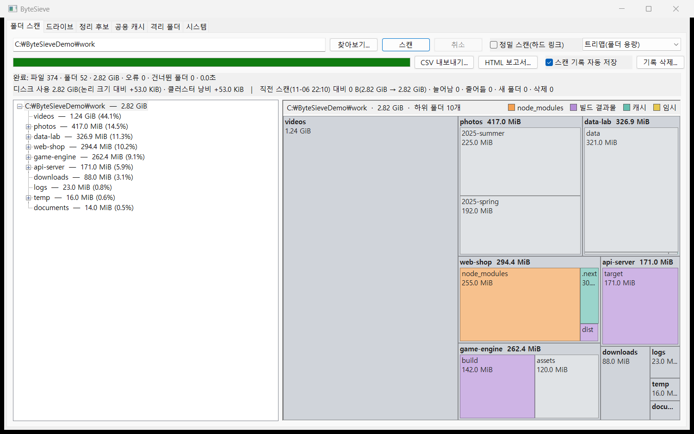
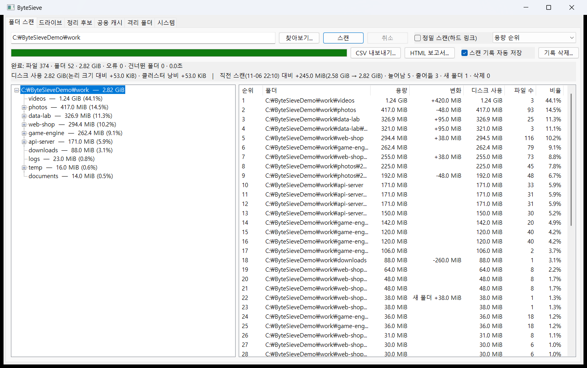
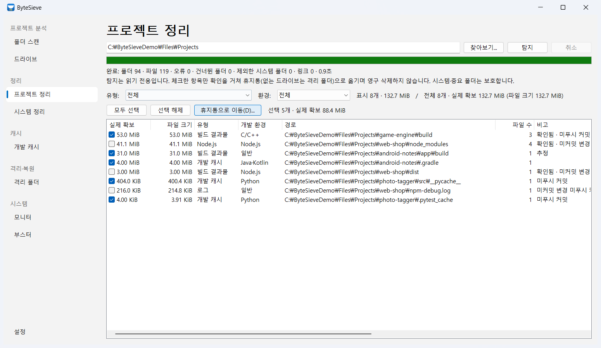
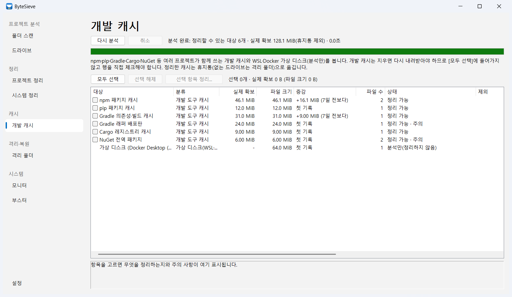
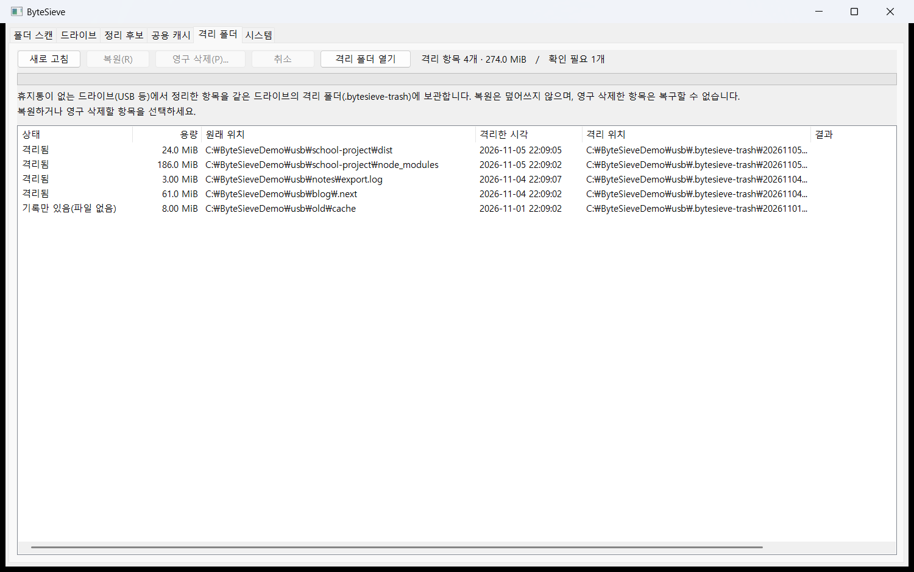
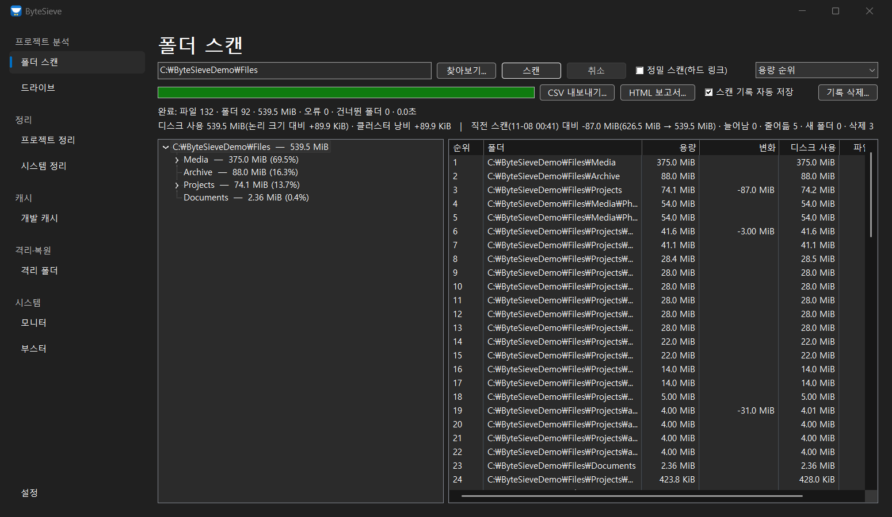
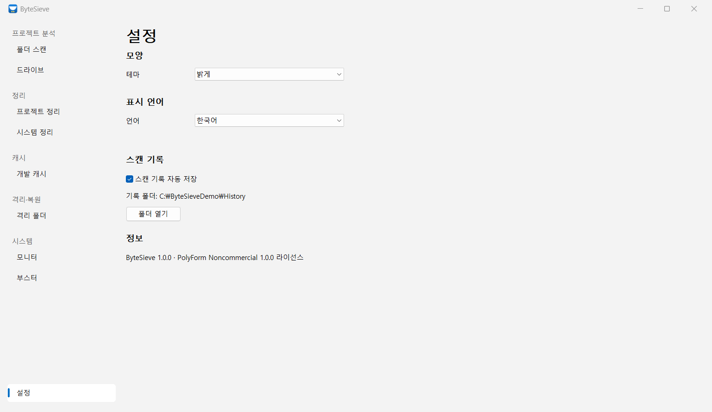

# ByteSieve

Windows용 디스크 사용량 분석·정리 도구입니다. C11과 Win32 API만으로 작성했으며 외부 라이브러리 의존성이 없습니다.
CLI(`disk-scanner`)와 Win32 GUI(`bytesieve-gui`)를 제공합니다.



## 설치

[GitHub Releases](https://github.com/gajigaji-dev/ByteSieve/releases)에서 내려받습니다(Windows 10/11, 64비트).

| 파일 | 용도 |
|---|---|
| `ByteSieve-<버전>-setup-x64.exe` | 설치 프로그램. 관리자 권한 없이 `%LOCALAPPDATA%\Programs\ByteSieve`에 설치하고 시작 메뉴 바로 가기를 만듭니다. 설치 언어(한국어·English·日本語·简体中文)가 앱 표시 언어가 됩니다 |
| `ByteSieve-<버전>-portable-x64.zip` | 설치 없이 실행. 압축을 풀고 `bytesieve-gui.exe`를 실행합니다 |
| `SHA256SUMS.txt` | 내려받은 파일 확인용 |

- 코드 서명이 없어 처음 실행할 때 **Windows SmartScreen** 경고("Windows의 PC 보호")가 나올 수 있습니다.
  `Get-FileHash <파일> -Algorithm SHA256` 결과가 `SHA256SUMS.txt`와 같은지 확인한 뒤 [추가 정보] → [실행]을 누르세요.
- 설정(`HKCU\Software\ByteSieve`)·스캔 기록(`%LOCALAPPDATA%\ByteSieve\history`)·각 드라이브의 격리 폴더(`.bytesieve-trash`)는
  제거해도 지우지 않습니다(격리 항목은 정리 중에 옮긴 사용자 파일). 포터블 판도 같은 위치를 씁니다.
- 변경 내용은 [CHANGELOG.md](CHANGELOG.md), 배포 절차는 [docs/release.md](docs/release.md)에 있습니다.

## 주요 기능

| 기능 | 내용 |
|---|---|
| 폴더 스캔 | 파일 수·폴더 수·총 용량 집계, 폴더 트리와 용량 순위 |
| 트리맵 | 폴더 용량을 사각형 크기로 2단계까지 표시(스퀘어리파이드 배치). 클릭하면 트리에서 선택, 더블클릭으로 확대·Backspace로 상위 폴더, 우클릭 메뉴(탐색기에서 열기·경로 복사·색 구분: 깊이/최상위 폴더/정리 후보) |
| 디스크 사용량 분석 | 논리 크기와 실제 할당 크기(size on disk)의 차이를 클러스터 낭비·NTFS 압축·스파스·클라우드 전용으로 분류 |
| 정밀 스캔(하드 링크 보정) | 선택하면 파일 ID·볼륨으로 같은 실제 파일을 알아내 하드 링크로 중복 집계된 용량을 보정하고, 폴더별로 기본 집계와 중복 제외 용량·실제 디스크 사용을 함께 표시 |
| 폴더별 용량 변화 추적 | 스냅숏을 저장해 다음 스캔 때 늘어남·줄어듦·새 폴더·삭제된 폴더를 비교 |
| 결과 내보내기 | 스캔 결과를 CSV(Excel에서 한글이 깨지지 않는 UTF-8 BOM)와 HTML 보고서(요약·통계·용량 순위 표)로 저장 |
| 스캔 기록 관리 | GUI에서 스캔 기록 자동 저장을 켜고 끄며(재실행 후에도 유지), 확인 후 저장된 기록 삭제 |
| 프로젝트 정리 | 고른 폴더 안의 `node_modules`·빌드 결과물·개발 캐시·임시·로그(정리 후보)를 개발 환경(Node.js·Python·Rust·Java·.NET·C/C++·Go)별로 분류 |
| 실제 확보 용량 | 정리 대상마다 파일 크기 합이 아니라 지웠을 때 실제로 비는 용량을 표시: 디스크 할당 크기(압축·클라우드 전용 반영, MFT 상주 파일 0), 하드 링크로 대상 밖과 나누는 파일(pnpm store 와 공유하는 `node_modules` 등) 제외. 파일 내용은 읽지 않음 |
| 안전한 정리 | 고르고 확인한 항목만 **Windows 휴지통으로** 이동(영구 삭제 없음), 시스템·중요 폴더 보호. 프로그램 설치 경로(`Program Files`, `%LOCALAPPDATA%\Programs`, Visual Studio·VS Code 설치 위치와 확장)와 앱 데이터 폴더(`AppData` 아래 앱별 폴더, `Temp` 제외), 브라우저·편집기의 LevelDB 데이터베이스 로그는 탐지·정리에서 제외 |
| 격리 폴더 | 휴지통이 없는 드라이브(USB 등)는 같은 드라이브의 격리 폴더(`.bytesieve-trash`)로 옮기고, GUI에서 복원(덮어쓰기 없음)하거나 두 번 확인한 뒤 영구 삭제(진행바·취소 지원) |
| 드라이브·시스템 | 드라이브별 사용률과 BitLocker(장치 암호화 포함) 상태(켜짐·잠김·일시 중단 등, 관리자 권한 불필요), RAM·CPU 사용률 1초 갱신과 60초 그래프 |
| 병렬 스캔 | 폴더 목록을 여러 스레드로 미리 읽어 `C:\Windows` 스캔을 16.4초 → 3.2초로 단축. 미리 읽기 작업 수를 제한해(동시 작업 5만여 개 → 약 1천 개) 속도는 그대로 두고 최대 메모리를 약 30% 절감 |
| JSON Lines 출력 | 다른 도구가 읽을 수 있는 UTF-8 이벤트 스트림(`--jsonl`) |
| Git 기반 프로젝트 분석 | 정리 후보를 Git 저장소(없으면 폴더)별로 묶고 브랜치·마지막 커밋·파일 마지막 수정 시각을 확인해 휴면 프로젝트(기본 90일, 바꿀 수 있음)를 자동 판정. 커밋하지 않은 변경·원격에 올리지 않은 커밋을 경고하고, 미커밋 변경이 있는 프로젝트의 후보는 [모두 선택]·CLI 기본 선택에서 뺌. 후보마다 lockfile 기반 복구 가능성(같은 버전 재설치·버전이 바뀔 수 있음·빌드하면 다시 생김·다시 생기지 않음) 표시. git.exe를 읽기 전용으로 실행하고(없으면 `.git` 직접 읽기) 외부 라이브러리 없음 |
| CLI 정리 | `disk-scanner find <dir>`로 프로젝트 정리 후보를 크기순으로 찾고(읽기 전용), `disk-scanner clean project <dir>` / `clean system`으로 정리. GUI 두 정리 페이지와 같은 탐지·정리 계획·실행 코드를 사용. `clean`은 기본 `--dry-run`(계획과 예상 결과만)이고 `--execute`면 확인 후 휴지통·격리 폴더로 옮김(스크립트는 `--yes`, 대화형이 아니면 `--yes` 없이 거부). 공용 개발 캐시는 `--include`로 직접 지정해야 하고, 휴지통 비우기(영구 삭제)는 CLI에서 지원하지 않음. `--json`(문서 하나)·`--jsonl`(이벤트) 출력, 종료 코드 0 완료·1 일부·2 오류 |
| 개발 환경 분석 | 공용 개발 캐시 15종(npm·pip·Gradle·Cargo·NuGet·pnpm·Yarn v1/Berry·Maven·Go 모듈/빌드·Conda)의 위치(환경 변수·설정 파일)·용량·실제 확보, WSL2·Docker Desktop 가상 디스크(`.vhdx`)의 크기·실제 점유와 줄이는 명령 안내(정리하지 않음), 분석할 때마다 캐시·가상 디스크 용량을 기록해 직전 기록보다 늘어난·줄어든 용량 표시(`disk-scanner devenv`, GUI [개발 캐시]의 증감 열) |
| 시스템 정리·개발 캐시 | GUI [시스템 정리] 페이지는 사용자 임시 파일(`%TEMP%`)·Windows 오류 보고서·휴지통·브라우저(Chrome·Edge·Firefox) 캐시를, [개발 캐시] 페이지는 공용 개발 캐시(npm·pip·Gradle·Cargo·NuGet·pnpm·Yarn·Maven·Go·Conda, 환경 변수·설정 파일까지 확인한 위치와 그 근거 표시)와 WSL·Docker 가상 디스크를 분석해(같은 Cleaner 엔진, 분석 범위만 나눔) 대상별 실제 확보 용량을 보여 주고, 고른 대상만 정리. 설정한 캐시 위치가 링크·캐시 구조가 아니면 이유와 함께 정리하지 않음. 휴지통 외에는 기존 안전 장치를 거쳐 휴지통(없는 드라이브는 격리 폴더)으로 옮기며, 최근 24시간 안에 바뀐 임시 파일·실행 중인 브라우저의 캐시는 건너뜀. 휴지통 비우기(영구 삭제)는 직접 고르고 따로 한 번 더 확인해야 함. 개발 도구 캐시도 [모두 선택]에 들어가지 않아 직접 골라야 하며, 오프라인 빌드가 안 되는 캐시는 주의로 표시 |
| Booster | 시작 프로그램 켜기/끄기(작업 관리자와 같은 방식, 등록은 지우지 않아 되돌릴 수 있음), 전체·프로세스별 CPU·메모리 사용량, 앱/백그라운드 구분과 고른 프로세스 끝내기(시스템·Windows 구성 요소·ByteSieve 자신은 보호, PID 재사용 확인) |
| 표시 언어·Windows 11 모양 | GUI를 한국어·영어·일본어·중국어 간체로 표시(환경 변수 → [설정]에서 고른 언어·설치 언어 → Windows 표시 언어 순, 언어별 글꼴, 문구 길이에 맞춘 단추 폭). 사이드바 메뉴·페이지 제목·[설정] 페이지와 여덟 페이지 모두(폴더 스캔의 컨트롤·상태 줄·분석 줄·트리맵·확인 창, 드라이브·프로젝트 정리·시스템 정리·개발 캐시·격리 폴더·모니터·Booster의 단추·목록·결과·상세 설명·상태 줄·확인 창)를 번역. [설정]에서 언어를 바꾸면 다시 시작하지 않고 모든 화면에 바로 적용. Windows 11 설정 앱처럼 목적별로 묶은 왼쪽 사이드바(키보드 ↑↓·Home·End, 아래 끝에 [설정]), 큰 페이지 제목, Fluent 색 토큰(밝게·어둡게, 강조색 선택 막대), 둥근 창 모서리·Mica 제목 표시줄 |
| 다크 모드·설정 | [설정] 페이지에서 테마(시스템 설정 따르기·밝게·어둡게)를 고르면 바로 창 전체에 적용(제목 표시줄·사이드바·목록·트리·입력 칸·단추·그래프·트리맵). 시스템 설정 따르기면 Windows 앱 모드가 바뀔 때 따라가고, 고대비 테마에서는 어둡게 하지 않음. 표시 언어(바로 적용)와 스캔 기록 자동 저장도 [설정]에서 바꾸며, 설정은 `HKCU\Software\ByteSieve`에 저장 |

## 빌드

**요구 사항**: Windows 10 이상, CMake 3.21 이상, Visual Studio(MSVC) 빌드 도구

```powershell
cmake -S . -B build
cmake --build build --config Debug      # 릴리스는 --config Release
```

결과물은 `build\Debug\` 아래의 `disk-scanner.exe`, `bytesieve-gui.exe`, `bytesieve-bench.exe`입니다.
버전은 `CMakeLists.txt`의 `project(ByteSieve VERSION ...)` 한 곳에서 정합니다(`disk-scanner --version`).

배포 파일(설치 프로그램·포터블 ZIP·SHA256)은 `tools\package.ps1`이 만듭니다(Release 빌드 → 테스트 → `dist\`).
설치 프로그램에는 [Inno Setup 6](https://jrsoftware.org/isinfo.php)이 필요하고, 없으면 `-NoInstaller`로 ZIP만 만듭니다.

```powershell
powershell -ExecutionPolicy Bypass -File tools\package.ps1
```

## 빠른 시작

```powershell
# CLI: 요약 출력
build\Debug\disk-scanner.exe C:\Users\me\Projects

# CLI: 직전 --track 스캔과 폴더별 용량 비교, JSON Lines 출력
build\Debug\disk-scanner.exe --track C:\Users\me\Projects
build\Debug\disk-scanner.exe --jsonl C:\Users\me\Projects > scan.jsonl

# CLI 정리: 후보 찾기 → 예상 결과 보기 → 확인 후 휴지통으로(GUI 정리 페이지와 같은 코드)
build\Debug\disk-scanner.exe find C:\Users\me\Projects
build\Debug\disk-scanner.exe clean project C:\Users\me\Projects --dry-run
build\Debug\disk-scanner.exe clean project C:\Users\me\Projects --category node_modules --execute
build\Debug\disk-scanner.exe clean system --include npm,pip --json

# 개발 환경 분석: 캐시·WSL/Docker 가상 디스크 용량과 지난 기록 대비 증감(읽기 전용)
build\Debug\disk-scanner.exe devenv

# GUI: 폴더를 지정하면 바로 스캔
build\Debug\bytesieve-gui.exe C:\Users\me\Projects
```

```
Total size:     12.21 KiB (12503 bytes)
On disk:        12.50 KiB (12800 bytes)
  Slack:        +297 bytes (cluster size 4.00 KiB)
Status:         complete (all directories scanned)
```

GUI는 왼쪽 사이드바에서 목적별로 묶은 여덟 페이지와 아래 끝의 **설정**을 고릅니다(마우스 클릭 또는 사이드바에 포커스를 두고 ↑·↓·Home·End).

| 그룹 | 페이지 |
|---|---|
| 프로젝트 분석 | 폴더 스캔 · 드라이브 |
| 정리 | 프로젝트 정리 · 시스템 정리 |
| 캐시 | 개발 캐시 |
| 격리·복원 | 격리 폴더 |
| 시스템 | 모니터 · 부스터 |
| (아래 끝) | 설정 |


- **폴더 스캔**: 경로 옆 **[정밀 스캔(하드 링크)]** 을 체크하면 하드 링크로 중복 집계된 용량을 보정해 기본 집계와의 차이를 함께 보여 줍니다.
  스캔이 끝나면 **[CSV 내보내기...]·[HTML 보고서...]** 로 결과를 저장하고, **[스캔 기록 자동 저장]** 체크·**[기록 삭제...]** 로 변화 추적 기록을 관리합니다.
  보기 콤보 상자에서 **트리맵(폴더 용량)** 을 고르면 순위 목록 자리에 트리맵이 나오며, 트리에서 고른 폴더가 트리맵의 기준 폴더가 됩니다.
- **드라이브**: 드라이브별 사용률과 BitLocker 암호화 상태(켜짐·잠김·일시 중단 등)를 관리자 권한 없이 보여 줍니다.
- **시스템 정리**: 페이지를 처음 열면 Windows 임시 파일·오류 보고서·휴지통·브라우저 캐시를 분석해 실제 확보 용량·파일 크기를 보여 줍니다.
  대상 체크 → [선택 항목 정리...] → 확인 순서로 정리하며, 휴지통 비우기(영구 삭제)는 [모두 선택]에 들어가지 않고 확인을 따로 받습니다.
- **개발 캐시**: 페이지를 처음 열면 npm·pip·Gradle·Cargo·NuGet 등 공용 개발 캐시와 WSL·Docker 가상 디스크(분석만)를 분석해 위치 근거·증감을 보여 줍니다.
  개발 캐시는 [모두 선택]에 들어가지 않아 행을 직접 체크해야 하며, 정리 뒤 오프라인 빌드가 안 되는 캐시는 주의로 표시합니다.
- **프로젝트 정리**: 폴더를 골라 [탐지] → 항목 체크 → [휴지통으로 이동...] → 확인 창에서 [예] 순서로 정리하며, 옮긴 항목은 Windows 휴지통에서 복원할 수 있습니다.
  항목마다 실제 확보 용량을 보여 줍니다(하드 링크로 다른 곳과 나누는 파일 제외).
- **부스터**: 시작 프로그램을 체크해 [사용 안 함]/[사용]으로 바꾸고, 프로세스 목록(CPU·메모리, 앱/백그라운드)에서 고른 프로세스를 확인 뒤 끝냅니다.
- **격리 폴더**: 휴지통이 없는 드라이브에서 정리한 항목을 복원하거나, 두 번 확인한 뒤 영구 삭제합니다(진행바 표시,
  [취소]나 창 닫기로 멈추면 남은 파일·기록은 보존).
- **모니터**: RAM·CPU 사용률을 1초마다 갱신하고 최근 60초 그래프를 그립니다.
- **설정**: 테마(시스템 설정 따르기·밝게·어둡게, 고르면 바로 적용), 표시 언어(고르면 바로 적용), 스캔 기록 자동 저장과 기록 폴더 열기.

| 폴더 스캔 | 프로젝트 정리 |
|---|---|
|  |  |
| **개발 캐시** | **격리 폴더** |
|  |  |
| **다크 모드** | **설정** |
|  |  |

모든 페이지의 화면과 설명은 [docs/gui.md](docs/gui.md)에 있습니다(화면은 개인정보가 없는 예제 데이터로 찍었습니다).

## 테스트

```powershell
ctest --test-dir build -C Debug --output-on-failure
```

단위 테스트 30개, CLI·도구 검사 32개, GUI 자체 검사 23개(총 85개)가 등록되어 있습니다.
GitHub Actions(`.github/workflows/ci.yml`)가 `main`·`dev`에 올리거나 PR을 열 때 Release 구성으로 빌드·테스트합니다.

## 문서

| 문서 | 내용 |
|---|---|
| [docs/cli.md](docs/cli.md) | CLI 옵션 전체, 종료 코드, 텍스트·`--track`·JSON Lines 출력 예, 정리 후보 찾기(`find`)·정리 명령(`clean project`·`clean system`, `--dry-run`·`--execute`, `--json` 문서 형식) |
| [docs/gui.md](docs/gui.md) | 페이지별 사용법과 스크린샷(정밀 스캔·트리맵·결과 내보내기·기록 관리·드라이브 암호화 상태·시스템 정리·프로젝트 정리·실제 확보 용량·격리 폴더 포함), 표시 언어 |
| [docs/ui-design.md](docs/ui-design.md) | Windows 11 Fluent 방향 UI 설계(단계·디자인 토큰·사이드바 구조), 다국어 규칙(문자열·글꼴·글자 길이), 설치 마법사 설계 |
| [docs/cleanup.md](docs/cleanup.md) | 정리 후보 탐지 규칙, 개발 환경 분류, 휴지통 이동 보호 조건, 공용 개발 캐시 보호 조건, 격리 폴더, 시스템 정리 대상·안전 규칙, 실제 확보 용량 계산, Booster 보호 규칙 |
| [docs/architecture.md](docs/architecture.md) | 기술 스택, 모듈 구조, 정리 계획(탐지 → 계획 → 실행, GUI·CLI 공통), 오류·취소 처리, 병렬 미리 열거(메모리 상한), 디스크 분석·정밀 스캔·변화 추적 설계 |
| [docs/performance.md](docs/performance.md) | `bytesieve-bench` 사용법과 스캐너 진단 값, 측정 결과, 병렬 스캔 메모리 최적화 전후 비교, 병목 분석 |
| [docs/testing.md](docs/testing.md) | 테스트 목록과 범위, GUI 자체 검사 옵션 |
| [docs/release.md](docs/release.md) | 배포 결정 사항, 산출물(설치 프로그램·포터블 ZIP·SHA256), 버전 관리, 릴리스 절차, 출시 전 확인 목록 |
| [CHANGELOG.md](CHANGELOG.md) | 버전별 변경 기록(릴리스 노트) |

## 디렉터리 구조

```
ByteSieve/
├── CMakeLists.txt     빌드·테스트·설치(install) 정의, 버전(project VERSION)
├── CHANGELOG.md       변경 기록(릴리스 노트)
├── .github/workflows/ CI(빌드·테스트), 릴리스(v* 태그 → 설치 프로그램·ZIP·SHA256 → 릴리스 초안)
├── docs/              상세 문서(screenshots/: 예제 데이터로 찍은 GUI 화면)
├── installer/         Inno Setup 설치 스크립트(bytesieve.iss), 배포 파일에 넣는 README.txt, 중국어 간체 번역
├── res/               exe 리소스: 앱 아이콘, 버전 정보, 앱 매니페스트(gui·cli)
├── tools/             package.ps1(릴리스 패키지), test_installer.ps1(설치 프로그램 검증), screenshots.ps1(예제 데이터로 화면 촬영), make_icon.py(아이콘 생성)
├── src/
│   ├── scanner, scan_model, scan_job, scan_history   폴더 열거(병렬 미리 열거·정밀 스캔)·트리 모델·스캔 스레드·변화 추적
│   ├── scan_export                                   스캔 결과 CSV·HTML 내보내기
│   ├── cleanup_rules, cleanup_scan, cleanup_job, cleanup_trash   정리 후보 탐지·휴지통 이동
│   ├── reclaim                                       실제 확보 용량(할당 크기·하드 링크)
│   ├── clean_plan                                    정리 계획: 탐지 결과 → 대상·선택 정책·요약 → 실행(GUI·CLI 공통)
│   ├── project_info                                  Git 기반 프로젝트 분석(묶기·Git 상태·휴면·복구 가능성)
│   ├── dev_cache                                     공용 개발 캐시 위치 탐지·용량 세기
│   ├── vdisk, devenv_history                         WSL2·Docker 가상 디스크 찾기, 개발 캐시 증가 기록
│   ├── quarantine                                    격리 폴더(이동·기록·복원·영구 삭제)
│   ├── cleaner, booster                              시스템 정크 분석·정리, 시작 프로그램·프로세스 관리
│   ├── drive, sysmon, path, size_format              드라이브·RAM/CPU 측정·경로·용량 표시
│   ├── treemap                                       트리맵 배치(스퀘어리파이드, 순수 계산)
│   ├── cli, cli_clean, cli_devenv, jsonl, main.c     CLI(disk-scanner, find·clean·devenv 명령 포함)
│   ├── gui_main.c, gui_nav                           GUI 창 골격(사이드바·페이지 전환·자체 검사 진행), 사이드바 컨트롤
│   ├── gui_scan, gui_drives, gui_cleaner, gui_booster, gui_cleanup, gui_quarantine, gui_monitor, gui_settings, gui_treemap   GUI 페이지 패널
│   ├── gui_progress                                  진행 막대 상태(진행·움직이는 막대·완료·취소·실패) 공용 처리
│   ├── version.h.in                                  버전 헤더 틀(CMake 가 build/generated/version.h 로 만듦)
│   ├── nav_model                                     사이드바 메뉴 모델(목적별 그룹·키 이동·위치 판정, 순수 계산)
│   ├── gui_theme, ui_lang, gui_status_text           GUI 공통 모양(창 외곽·밝게/어둡게 색 토큰·다크 모드 적용·언어별 글꼴·글자 폭), 표시 언어·번역 문자열, core 상태 번호 → 화면 문구
│   ├── app_settings                                  GUI 설정(테마·표시 언어) 저장·해석, 시스템 앱 모드·고대비
│   └── bench.c                                       성능 측정 도구(bytesieve-bench)
└── tests/             단위 테스트(test_*.c), CLI·GUI 검사 스크립트(*.cmake)
```

## 구현 상태와 향후 계획

CLI 스캐너, JSON Lines 출력, 개발 환경 분석(공용 캐시 15종·WSL2/Docker 가상 디스크·증가 기록), Git 기반 프로젝트 분석(휴면 판정·미커밋/미푸시 경고·복구 가능성), CLI 정리 후보 찾기·정리 명령(`find`·`clean --dry-run`·`--execute`, JSON 문서 출력, GUI와 같은 정리 계획·실행 코드), GUI 여덟 페이지(목적별 사이드바), 시스템 정리(임시 파일·오류 보고서·휴지통·브라우저 캐시·공용 개발 캐시(npm·pip·Gradle·Cargo·NuGet) 분석·정리), 프로젝트 정리(정리 후보 탐지·휴지통 이동), 실제 확보 용량(할당 크기·하드 링크 반영), Booster(시작 프로그램·프로세스 관리, CPU·메모리 사용량), 휴지통 없는 드라이브의 격리 폴더(복원·영구 삭제), 디스크 사용량 분석, 트리맵 시각화, 드라이브별 BitLocker 암호화 상태 표시, 정밀 스캔(하드 링크 중복 보정), 폴더별 변화 추적(자동 저장 설정·기록 삭제 포함), 스캔 결과 CSV·HTML 내보내기, 병렬 스캔(미리 읽기 작업 수 제한으로 메모리 절감), GUI 표시 언어(한국어·영어·일본어·중국어 간체, 사이드바·페이지 제목·설정 페이지와 모든 페이지의 컨트롤·상태 줄·결과·상세 설명·확인 창, 실행 중 언어 바꾸기), Windows 11 창 외곽과 사이드바 탐색, 다크 모드(시스템 설정 따르기 포함)와 설정 페이지(테마·표시 언어·스캔 기록·버전 정보), 진행 막대의 완료·취소·실패 표시, 배포(설치 프로그램·포터블 ZIP·SHA256, exe 버전 정보·아이콘·매니페스트, 정적 C 런타임, CI·릴리스 자동화)가 구현되어 있습니다.

### 향후 개선 계획(미구현)

아래 항목은 아직 구현되지 않았습니다.

**기능**
- 시스템 정리 대상 확대: 썸네일 캐시, Windows 업데이트 다운로드 캐시·`C:\Windows\Temp`(관리자 권한·보호 경로라 지금은 대상에서 뺌), 다른 브라우저(Whale·Brave 등)
- Booster 보강: 작업 스케줄러·서비스의 시작 항목, 시작 영향(부팅 시간) 측정, 프로세스 목록 자동 갱신
- 암호화 정보 보강: BitLocker 외 암호화(VeraCrypt 등) 인식, 암호화 방식·진행률 표시(지금은 관리자 권한 없이 읽을 수 있는 BitLocker 상태만 표시)
- 트리맵 보강: 정밀 스캔의 중복 제외 용량·디스크 사용 기준 선택, 파일 단위 블록(지금은 폴더 바로 아래 파일을 한 블록으로 묶음)

**정확도·성능**
- 실제 확보 용량 보강: 여러 항목을 함께 고를 때 항목끼리 나누는 하드 링크까지 합쳐 계산(지금은 항목마다 판정해 실제보다 작게 말할 수 있음),
  프로젝트 정리 목록을 실제 확보 순으로 정렬하는 선택(지금은 파일 크기 순), 폴더 스캔 CLI(`--jsonl`)의 실제 확보 용량 출력
  (정리 명령 `clean --jsonl`은 출력함)
- CLI 정리 보강: 격리 폴더 목록·복원·영구 삭제(`clean quarantine`), 진행률 표시, 정리 결과를 변화 추적 기록과 연결,
  `find`의 크기·마지막 수정 기준 거르기(`--min-size`·`--older-than`)와 정렬 선택
- 개발 환경 분석 보강: 가상 디스크 안의 실제 사용량(배포판 안 `df`)과 줄일 수 있는 양 추정, 증가 기록 그래프(GUI),
  Bun·Deno·Poetry·uv·Bazel 캐시, Docker 이미지·빌드 캐시 크기(`docker system df`), 기록 삭제에 개발 캐시 기록 포함
- 프로젝트 분석 보강: 휴면 프로젝트의 후보만 고르는 선택(`--dormant-only`, GUI 필터), 프로젝트 단위 목록 보기(GUI 그룹),
  휴면 기준 일수를 GUI에서 바꾸기, 원격 정보가 오래됐을 때(`git fetch` 전) 알림, Mercurial 등 다른 버전 관리 도구
- 설치 경로 보호 확대: 레지스트리·`AppData`에 없는 임의 위치(예: `D:\tools`에 압축을 푼 VS Code 포터블)의 개발 도구도 보호 경로로 인식
- 정밀 스캔의 CLI·CSV 지원: 지금은 GUI와 HTML 보고서에서만 하드 링크 보정 결과를 보여 줌
**UI·버그 수정**
- Windows 11 Fluent 디자인 나머지 단계([docs/ui-design.md](docs/ui-design.md)): 사이드바 아이콘·좁은 창에서 접기,
  트리맵·그래프·드라이브 막대를 Direct2D로 다시 그리기, 모니터마다 다른 배율(Per-Monitor DPI) 지원
- 다크 모드 남은 부분: 확인 창(MessageBox)·오른쪽 클릭 메뉴·진행 막대는 아직 밝게 그려짐(Windows가 그리는 부분), 어둡게일 때 체크 상자는 비주얼 스타일 없이 그려짐
- 번역 범위 확대: HTML 보고서를 영어·일본어·중국어 간체로(GUI 화면은 모든 페이지 번역 완료, CLI 출력은 한국어)

**배포·문서**
- 배포 이후([docs/release.md](docs/release.md#나중에-검토할-것)): 코드 서명(SmartScreen 경고 제거), winget 등록,
  설치 프로그램에서 `disk-scanner`를 PATH에 추가하는 선택, 업데이트 확인

## 라이선스

[PolyForm Noncommercial License 1.0.0](LICENSE) © 2026 gajigaji04

**비상업적 용도로만** 사용·수정·재배포할 수 있습니다.

- 허용: 개인 용도(공부, 연구·실험, 취미 등)와 자선 단체·교육 기관·공공 연구 기관·공공 안전 및 보건 기관·환경 보호 단체·정부 기관의 사용
- 허용되지 않음: 기업 업무용 사용, 판매, 상업 제품에 포함하는 것 등 상업적 이용. 상업적 이용은 저작권자(gajigaji04, <gajigaji0908@gmail.com>)에게 별도로 허락을 받아야 합니다.
- 재배포할 때는 라이선스 문구(또는 URL)와 `LICENSE` 맨 위의 `Required Notice:` 줄을 함께 전달해야 합니다.

설치 프로그램은 라이선스 화면에서 이 라이선스를 쉽게 풀어 쓴 이용약관(`installer/terms/`, 한국어·English·日本語·简体中文)을
원문과 함께 보여 주며, 약관은 설치 폴더의 `terms\`에서도 볼 수 있습니다. 약관과 원문이 다르면 원문이 우선합니다.
일본어·중국어 약관은 검토가 필요한 번역 초안입니다.

이 라이선스로 바꾸기 전에 MIT License로 배포된 버전은, 그 버전을 받은 사람에게 MIT 조건이 그대로 적용됩니다.
