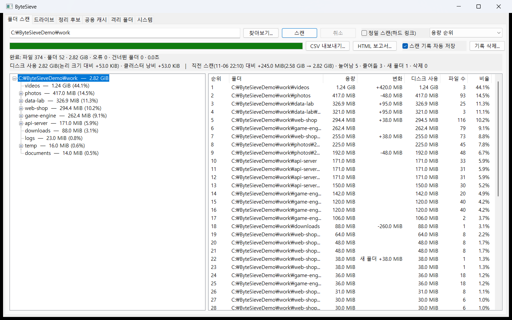
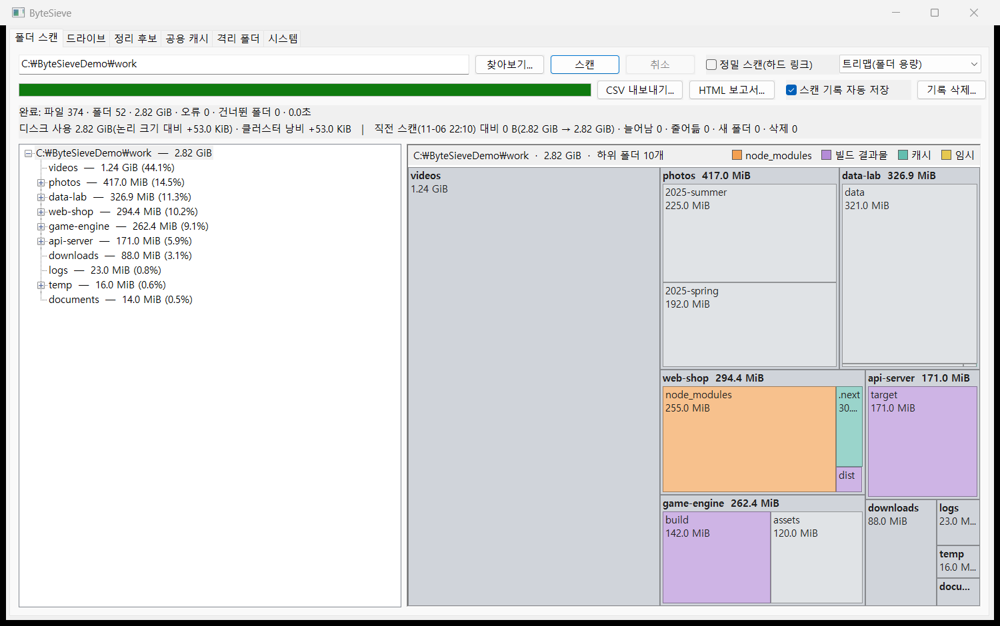
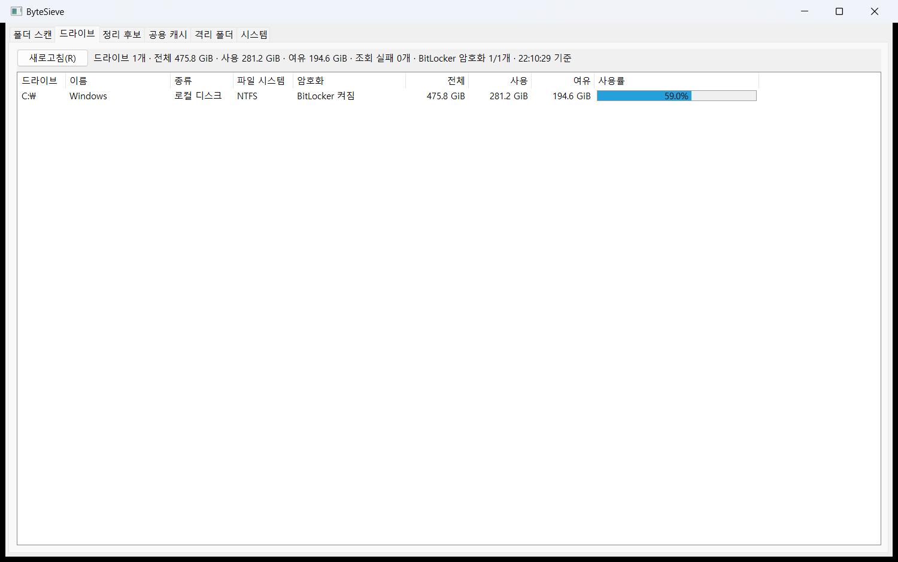
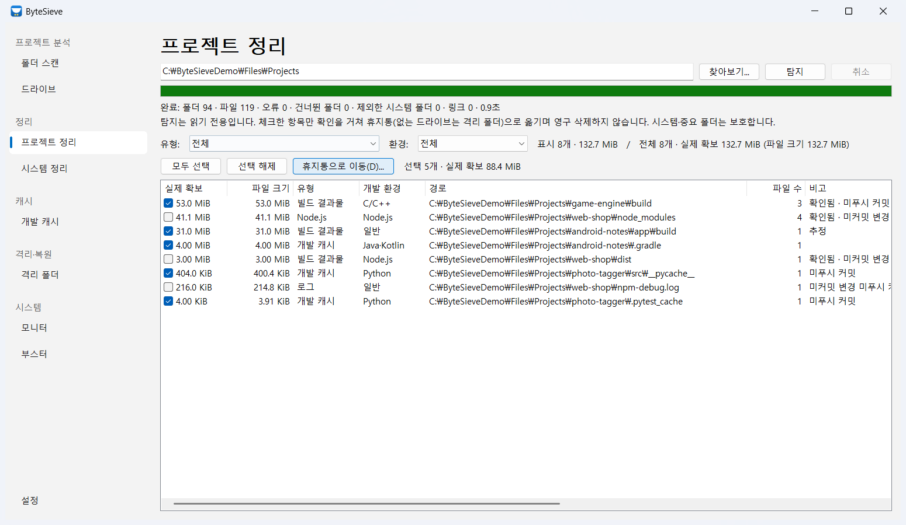
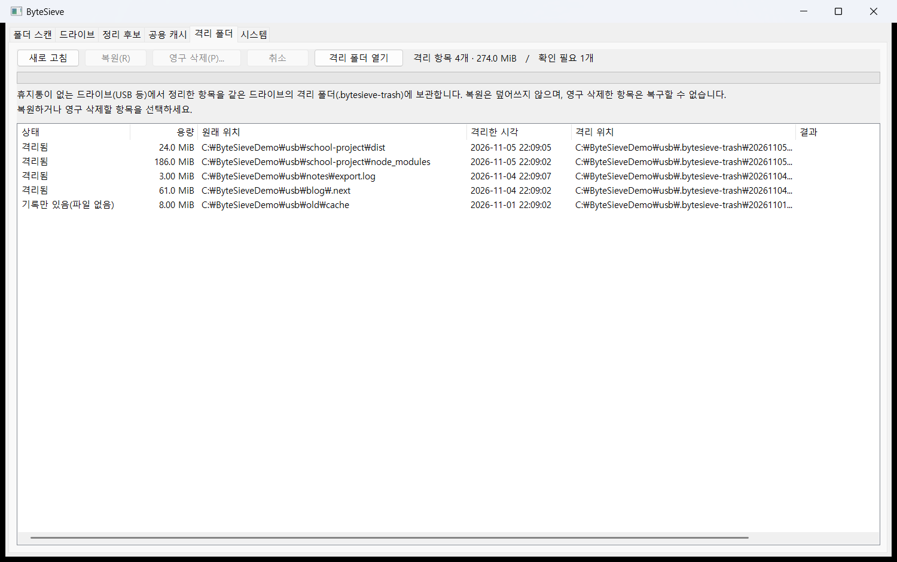
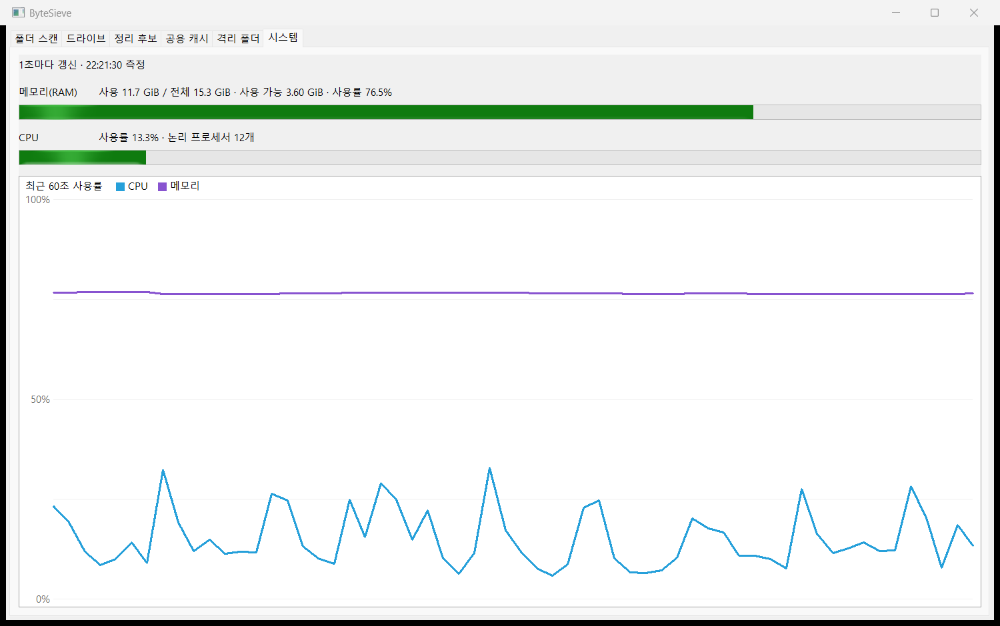

# GUI 사용법 (`bytesieve-gui`)

```powershell
build\Debug\bytesieve-gui.exe                          # 창을 열고 경로를 고른 뒤 [스캔]
build\Debug\bytesieve-gui.exe C:\Users\me\Projects     # 폴더를 지정하면 바로 스캔
```

창은 일곱 탭(폴더 스캔·드라이브·시스템 정리·프로젝트 정리·부스터·격리 폴더·시스템)으로 나뉩니다.
Windows 11에서는 창 모서리가 둥글고 제목 표시줄에 Mica 배경이 적용됩니다.

## 표시 언어

한국어·영어·일본어·중국어 간체로 표시합니다. 언어는 시작할 때 다음 순서로 정합니다.

1. 환경 변수 `BYTESIEVE_LANG`(`ko`, `en`, `ja`, `zh-Hans`. `ja-JP`·`zh-CN`처럼 지역을 붙여도 됨)
2. 레지스트리 `HKCU\Software\ByteSieve`의 `Language` 값(설치 프로그램이 설치 언어로 기록)
3. Windows 표시 언어(그 밖의 언어와 중국어 번체는 영어)

```powershell
$env:BYTESIEVE_LANG = "ja"; build\Debug\bytesieve-gui.exe
```

- 글꼴은 언어에 맞춰 고릅니다(한국어 Malgun Gothic, 영어 Segoe UI Variable Text, 일본어 Yu Gothic UI, 중국어 Microsoft YaHei UI).
  크기는 Windows 텍스트 크기 설정을 따릅니다.
- 단추 폭과 최소 창 크기는 문구 길이에 맞춰 정하므로 영어처럼 긴 문구도 잘리지 않습니다.
- **지금 번역된 범위**: 탭 이름, 폴더 스캔 탭의 단추·체크 상자·입력 칸 안내·보기 목록·순위 목록 열·폴더 상태 표시(`[읽기 실패]` 등).
  상태 줄 문구, 다른 탭, 확인 창, HTML 보고서는 아직 한국어입니다([ui-design.md](ui-design.md)의 단계 참고).

## 폴더 스캔



- 경로를 입력하거나 [찾아보기]로 고른 뒤 [스캔] (또는 Enter). 스캔 중에는 [취소]로 멈출 수 있고, 그때까지 읽은 결과를 보여 줍니다.
- 상태 줄: 파일·폴더 수, 용량, 오류 수, 현재 폴더. 둘째 줄: 디스크 분석(디스크 사용, 클러스터 낭비·압축 등)과 직전 스캔 대비 변화 요약.
- 왼쪽 **폴더 트리**는 용량순으로 정렬되며 펼칠 때 하위 항목을 채웁니다.
- 오른쪽은 보기 콤보 상자로 **용량 순위 / 디스크 사용 순위 / 변화 순위(직전 스캔 대비) / 중복 제외 용량 순위 / 하드 링크 중복 순위 /
  트리맵(폴더 용량)** 을 고릅니다(트리맵은 [아래](#트리맵) 참고).
  순위 목록의 열은 순위·폴더·용량·변화·디스크 사용·파일 수·비율이며, 항목을 더블클릭하면 트리에서 그 폴더를 찾아 선택합니다.

### 트리맵

보기 콤보 상자에서 **트리맵(폴더 용량)** 을 고르면 오른쪽 목록 자리에 트리맵이 나옵니다.



- 왼쪽 트리에서 고른 폴더(기준 폴더)를 사각형 하나로 보고, 하위 폴더를 용량에 비례하는 사각형으로 나눕니다(스퀘어리파이드 배치라
  정사각형에 가깝게 나뉨). 충분히 큰 폴더는 제목 줄 아래에 그 하위 폴더를 한 단계 더 보여 줍니다(2단계).
- 폴더 바로 아래 파일은 **파일 n개** 블록 하나로 묶고, 한 단계의 하위 폴더가 300개를 넘으면 작은 것들을 **그 밖의 폴더 n개** 블록으로 묶습니다.
- 용량은 경로마다 센 기본 용량(`total_bytes`)입니다. 정밀 스캔이어도 하드 링크 중복을 빼지 않습니다.
- 위쪽 안내 줄: 기준 폴더 경로·용량·하위 폴더 수.
- 마우스를 올리면 경로, 용량, 기준 폴더·전체 대비 비율, 하위 폴더·파일 수를 보여 줍니다(이름이 정리 후보 규칙에 맞으면 그 종류도).
- **클릭**: 트리에서 그 폴더를 고릅니다(기준 폴더는 그대로). **더블클릭·Enter**: 그 폴더로 확대. **Backspace**: 상위 폴더로.
- **우클릭 메뉴**: 이 폴더로 확대, 상위 폴더로, 탐색기에서 열기, 경로 복사, 색 구분.
- **색 구분**: 깊이(단계별) / 최상위 폴더(기준 폴더 바로 아래 폴더마다 다른 색) / 정리 후보(이름이 `node_modules`·빌드 결과물·캐시·임시
  규칙에 맞는 폴더와 그 안을 종류별 색, 안내 줄에 범례). 정리 후보 색은 이름만 보므로, 실제 정리 대상인지(표시 파일·보호 경로)는
  [프로젝트 정리] 탭에서 확인하세요. 트리맵은 읽기 전용이며 파일을 바꾸지 않습니다.

### 정밀 스캔(하드 링크 중복 보정)

기본 스캔은 경로마다 파일 크기를 셉니다. 그래서 하드 링크로 한 실제 파일이 여러 경로에 있으면(`C:\Windows\WinSxS` 등) 같은 용량을 여러 번 셉니다.
경로 옆의 **[정밀 스캔(하드 링크)]** 를 체크하고 스캔하면 이를 보정합니다(스캔 중에는 바꿀 수 없음).

- 폴더 열거로 파일마다 Windows 파일 ID(128비트)를 받고 폴더 핸들로 볼륨 일련번호를 구해, (볼륨, 파일 ID)가 같으면 같은 실제 파일로 봅니다.
  파일을 하나씩 열지 않으므로 기본 스캔과 속도가 비슷하며, 본 파일 ID를 기억하느라 파일 하나에 약 40바이트를 더 씁니다.
- 같은 실제 파일은 **처음 만난 경로**에만 세고 나머지 경로는 "하드 링크 중복"으로 따로 셉니다(`du`와 같은 방식, 작업 스레드 수와 상관없이 같은 결과).
  그래서 폴더별 중복 제외 용량을 더하면 상위 폴더와 맞습니다. 다른 폴더와 실제 파일을 나눠 쓰는 폴더는 그 폴더만 지울 때 확보되는 용량보다 작게 보일 수 있습니다.
- 경로마다 센 기본 집계(**용량** 열, 기록 스냅숏)는 기본 스캔과 똑같고, 정밀 스캔 결과에만 다음이 더해집니다.
  - **중복 제외** 열(하드 링크 중복을 뺀 용량)과 **하드 링크 중복** 열(기본 집계와의 차이와 중복 경로 수, 예: `-1.20 GiB (532개)`). 기본 스캔에서는 숨겨집니다.
  - 둘째 줄: `정밀 스캔: 중복 제외 X(기본 Y, 하드 링크 중복 n개 -Z) · 실제 디스크 사용 W`. 실제 디스크 사용은 할당 크기에서 중복 몫을 뺀 값입니다.
  - 트리: 중복이 있는 폴더에 ` · 중복 제외 X`를 덧붙입니다.
  - 보기: **중복 제외 용량 순위**, **하드 링크 중복 순위**(중복이 있는 폴더만).
- 진행 중 상태 줄에 지금까지 찾은 하드 링크 중복 수·용량을 보여 주며, 끝나면 `정밀 스캔 완료: …`로 표시합니다.
- 하드 링크가 없는 파일 시스템(FAT·exFAT)은 확인하지 않고 "보정할 것이 없음"으로 표시하고, 파일 ID를 얻지 못한 파일은 경로마다 셉니다("파일 ID 모름 n개").
- HTML 보고서의 디스크 사용 분석에도 하드 링크 중복·중복 제외 용량·실제 디스크 사용을 적습니다. CSV와 CLI는 아직 기본 집계만 씁니다.
- 스캔이 끝나면 스냅숏을 `BYTESIEVE_HISTORY_DIR` 또는 `%LOCALAPPDATA%\ByteSieve\history`에 자동 저장합니다(취소한 스캔은 저장하지 않음).
- 진행 막대 오른쪽의 **[스캔 기록 자동 저장]** 체크박스로 저장 여부를 정합니다(기본값 켬).
  - 끄면 이후 스캔 결과를 저장하지 않습니다. 이미 저장된 기록이 있으면 비교는 계속하며, 둘째 줄에 "자동 저장이 꺼져 있어 이번 스캔은 기록하지 않았습니다"를 표시합니다.
  - 설정은 기록 폴더의 `settings.txt`에 임시 파일→바꿔치기로 저장해 다시 실행해도 유지됩니다. 저장하지 못하면 체크 상태를 되돌리고 상태 줄에 오류를 알립니다.
- **[기록 삭제...]** 는 저장된 스캔 기록(`<16자리 16진수>.snap`)을 모두 지웁니다. 기록이 없거나 스캔 중이면 누를 수 없습니다.
  - 지우기 전에 개수·기록 폴더·되돌릴 수 없다는 안내로 확인합니다(기본 버튼 [아니요]). 같은 폴더를 쓰는 CLI `--track` 기록도 함께 지워집니다.
  - 설정 파일, 형식이 다른 파일, 폴더·링크는 건드리지 않습니다. 사용 중인 파일 등 일부를 지우지 못해도 나머지는 지우고, 지운 개수와 실패 개수·오류를 상태 줄에 씁니다.
  - 지금 보이는 비교의 기준 기록이 지워지면 변화 열·변화 순위·둘째 줄의 비교 요약도 지웁니다.

### 결과 내보내기

진행 막대 오른쪽의 **[CSV 내보내기...]**·**[HTML 보고서...]** 로 지금 스캔 결과를 파일로 저장합니다.
스캔이 끝난 뒤(취소한 스캔은 그때까지 모은 결과)에만 누를 수 있고, 스캔 중이거나 대상 폴더를 열지 못했으면 꺼집니다.

- 저장 대화 상자에서 위치와 이름을 고릅니다. 기본 이름은 `ByteSieve-<대상 폴더 이름>-YYYYMMDD-HHMM.csv`(또는 `.html`)이며,
  같은 이름의 파일이 있으면 덮어쓸지 묻습니다.
- **CSV**: 모든 폴더를 한 줄씩 씁니다. 첫 줄은 대상 폴더, 이어서 크기 내림차순입니다.
  - 열: 경로, 폴더명, 깊이, 크기(바이트), 크기, 디스크 사용(바이트), 파일 수(하위 포함), 하위 폴더 수, 바로 아래 파일 수, 바로 아래 파일 크기(바이트), 비율(%), 상태
  - Excel에서 한글이 깨지지 않도록 UTF-8 BOM과 CRLF를 씁니다. 숫자 열은 정렬할 수 있게 바이트 단위 숫자로 씁니다.
  - `=`·`+`·`-`·`@`로 시작하는 폴더 이름은 Excel이 수식으로 실행하지 않도록 앞에 `'`를 붙입니다.
- **HTML 보고서**: 브라우저로 여는 한 파일짜리 보고서입니다(외부 파일·스크립트 없음, 다크 모드 지원).
  - 전체 요약(용량·디스크 사용·파일·폴더·오류, 상태·완료 시각·걸린 시간), 파일·폴더 통계(평균 파일 크기, 가장 깊은 깊이, 빈 폴더 등),
    디스크 사용 분석, 최상위 폴더 구성, **폴더별 용량 순위 상위 100개 표**(비율 막대), 오류 목록(최대 50개)
  - 크기 칸에 마우스를 올리면 정확한 바이트 수가 보입니다.
- 파일은 임시 파일에 다 쓴 뒤 바꿔치기하므로, 실패해도 기존 파일이 반쯤 덮이지 않습니다. 실패하면 원인(권한 없음,
  Excel 등이 파일 사용 중, 디스크 공간 부족, 위치 없음)을 창과 상태 줄로 알립니다.

## 드라이브



드라이브별 문자·이름·종류·파일 시스템·암호화·전체·사용·여유 용량과 사용률 막대(90% 이상 빨간색). 미디어가 없거나 분리된 드라이브는
상태와 오류 코드로 표시합니다. 탭을 처음 열 때와 [새로고침] (Alt+R) 때 작업 스레드에서 조회합니다.

**암호화** 열은 로컬·이동식 드라이브의 BitLocker 상태(Windows 장치 암호화 포함)를 보여 줍니다. 요약 줄에는 상태를 알아낸
드라이브 중 암호화된 수(`BitLocker 암호화 n/m개`)가 나옵니다.

| 표시 | 뜻 |
|---|---|
| BitLocker 켜짐 | 암호화됨, 잠금 해제된 상태 |
| BitLocker 잠김 | 암호화됨, 잠김. 용량을 읽을 수 없어 사용률 칸에 `BitLocker로 잠김`으로 표시(탐색기에서 잠금 해제) |
| BitLocker 일시 중단(보호 꺼짐) | 암호화돼 있지만 키 보호가 일시 중단됨 |
| BitLocker 활성화 대기 | 암호화돼 있지만 아직 키 보호기가 없음(장치 암호화를 켜기 전 상태 등) |
| BitLocker 암호화 중 / 해독 중 | 진행 중 |
| 암호화 안 됨 | BitLocker 꺼짐 |
| 정보 없음 | BitLocker를 쓸 수 없는 볼륨 등 |
| 알 수 없음(값 n) / 조회 실패(0x…) | 뜻을 모르는 값, 셸 속성 조회 오류 |
| - | 조회하지 않음(네트워크·광학 드라이브, 미디어 없음) |

- 관리자 권한 없이 탐색기의 드라이브 자물쇠 아이콘과 같은 셸 속성(`System.Volume.BitLockerProtection`)을 읽습니다.
  관리자 권한이 필요한 WMI·`manage-bde`는 쓰지 않습니다.
- 이 속성 값의 뜻은 Microsoft가 문서로 정해 두지 않았습니다. 널리 알려진 값만 상태로 바꾸고 나머지는 원래 값을 그대로 보여 줍니다.
- BitLocker가 아닌 암호화(VeraCrypt 등)는 알 수 없으며, 암호화 방식·진행률은 표시하지 않습니다.

## 시스템 정리

프로젝트 밖의 시스템 정크와, 패키지 관리자·빌드 도구가 사용자 폴더에 두고 여러 프로젝트가 함께 쓰는 **공용 개발 캐시**를
한 목록에서 분석하고 고른 대상만 정리합니다(예전 [클리너]·[공용 캐시] 탭을 합쳤습니다).
탭을 처음 열면 분석을 시작하며(읽기 전용), [다시 분석]으로 다시 셀 수 있습니다.

| 분류 | 대상 | 정리 방법 |
|---|---|---|
| Windows 임시 파일 | 사용자 임시 파일(`%TEMP%` 바로 아래 항목), Windows 오류 보고서(`%LOCALAPPDATA%\Microsoft\Windows\WER\ReportArchive`·`ReportQueue`) | 휴지통(없는 드라이브는 격리 폴더)으로 이동 |
| 휴지통 | 모든 드라이브의 휴지통 | **비우기 = 영구 삭제** |
| 브라우저 캐시 | Chrome·Edge 프로필마다 `Cache`·`Code Cache`·`GPUCache`, Firefox 프로필마다 `cache2` | 휴지통으로 이동 |
| 개발 도구 캐시 | 아래 표의 npm·pip·Gradle·Cargo·NuGet 공용 캐시(찾은 것마다 한 행) | 휴지통으로 이동 |

| 도구 | 캐시 | 기본 위치 |
|---|---|---|
| npm | 패키지 캐시 | `%LOCALAPPDATA%\npm-cache` |
| pip | 패키지 캐시 | `%LOCALAPPDATA%\pip\Cache` |
| Gradle | 의존성·빌드 캐시 / 래퍼 배포판 | `%USERPROFILE%\.gradle\caches` / `\wrapper\dists` |
| Cargo | 레지스트리 캐시 / git 의존성 | `%USERPROFILE%\.cargo\registry` / `\git` |
| NuGet | 전역 패키지 / HTTP 캐시 | `%USERPROFILE%\.nuget\packages` / `%LOCALAPPDATA%\NuGet\v3-cache`(또는 `http-cache`) |
| pnpm | 패키지 저장소 | `%LOCALAPPDATA%\pnpm\store` |
| Yarn | 패키지 캐시(v1) / 전역 캐시(Berry) | `%LOCALAPPDATA%\Yarn\Cache` / `%LOCALAPPDATA%\Yarn\Berry\cache` |
| Maven | 로컬 저장소(주의) | `%USERPROFILE%\.m2\repository` |
| Go | 모듈 캐시 / 빌드 캐시 | `%USERPROFILE%\go\pkg\mod` / `%LOCALAPPDATA%\go-build` |
| Conda | 패키지 캐시(주의) | `%USERPROFILE%\.conda\pkgs`(또는 `miniconda3`·`anaconda3`·`miniforge3`·`mambaforge`의 `pkgs`) |

**가상 디스크(WSL·Docker)** 분류에는 WSL 배포판과 Docker Desktop의 `.vhdx`가 "분석만(정리하지 않음)" 행으로 나옵니다. 행을 고르면 실제 점유와
줄이는 명령(`wsl --shutdown` 뒤 `Optimize-VHD`/`diskpart compact vdisk`)이 아래 칸에 나옵니다. 체크할 수 없습니다.

**증감** 열: 개발 캐시·가상 디스크는 분석할 때마다 용량을 기록 폴더의 `devenv-history.tsv`에 남기고([스캔 기록 자동 저장]이 켜져 있을 때),
직전 기록보다 늘어난·줄어든 용량을 "+1.20 GiB (7일 전보다)"처럼 보여 줍니다. 처음이면 "첫 기록"입니다.

- 목록 열: 대상, 분류, **실제 확보**, 파일 크기, 파일 수, 상태, 제외, 위치, 위치 근거. 행을 고르면 아래 칸에 정리하면 어떻게 되는지와
  주의 사항, 위치 근거, 하드 링크로 빠진 용량이 나옵니다.
- **위치 근거**(개발 도구 캐시): 환경 변수(`npm_config_cache`, `PIP_CACHE_DIR`, `GRADLE_USER_HOME`, `CARGO_HOME`, `NUGET_PACKAGES`,
  `NUGET_HTTP_CACHE_PATH`, `npm_config_store_dir`, `YARN_CACHE_FOLDER`, `YARN_GLOBAL_FOLDER`, `GOMODCACHE`, `GOPATH`, `GOCACHE`, `CONDA_PKGS_DIRS`)와
  설정 파일(`.npmrc`의 `cache=`·`store-dir`, `pip.ini`의 `cache-dir`, `NuGet.Config`의 `globalPackagesFolder`, `.m2\settings.xml`의 `localRepository`,
  `%APPDATA%\go\env`)을 먼저 보고,
  없으면 기본 위치를 씁니다. 어디서 정했는지(`기본 위치`, `환경 변수 …`, `설정 파일 …`)를 보여 줍니다.
- **상태**: 정리 가능 / 정리 가능 · 주의 / 정리 가능 · 영구 삭제(휴지통) / 정리할 것 없음 / 없음(설치하지 않음) /
  프로그램 실행 중(브라우저가 실행 중이면 그 캐시는 정리하지 않음) / 보호·확인 불가로 정리 안 함 / 조회 실패.
  설정한 캐시 위치에 문제가 있으면 정리하지 않고 이유를 보여 줍니다: `링크라 정리하지 않음`, `폴더가 아님`, `캐시 구조가 아니라 정리하지 않음`
  (예: `NUGET_HTTP_CACHE_PATH`가 문서 폴더를 가리킴). 설치하지 않아 없는 캐시는 목록에 넣지 않습니다.
- **제외**: 최근 24시간 안에 바뀐 임시 파일(폴더는 안에 최근 파일이 하나라도 있으면 폴더 전체)과, 보호 경로·링크·다 읽지 못한 항목은 정리 대상에서 빼고 개수를 보여 줍니다.
- [모두 선택]은 정리할 수 있는 대상을 고르되 **휴지통과 개발 도구 캐시는 고르지 않습니다.** 휴지통 비우기는 영구 삭제이고,
  개발 도구 캐시는 여러 프로젝트가 함께 써서 지우면 다시 내려받아야 하므로 둘 다 직접 체크해야 합니다(임시 파일을 정리하려다 함께 지우는 일 방지).
  [선택 해제]는 직접 체크한 대상까지 모두 해제합니다.
- 정리하면 인터넷 없이 빌드할 수 없는 개발 도구 캐시(Gradle 래퍼 배포판, NuGet 전역 패키지)는 **주의**로 알립니다:
  상태 칸 "정리 가능 · 주의", 설명 칸 [주의], 선택 요약 "주의 n개", 확인 창의 [주의] 표시와 경고 문단(경고 아이콘).
  개발 도구 캐시를 하나라도 고르면 확인 창에 "다음 빌드·설치 때 다시 내려받는다"는 안내가 붙습니다.
  해당 도구(Gradle 데몬, dotnet, cargo 등)가 실행 중이면 사용 중 오류로 일부가 실패할 수 있으니 끝낸 뒤 정리하세요.
- [선택 항목 정리...] → 확인 창(대상마다 실제 확보 용량, 기본 [아니요]) → 휴지통을 골랐으면 영구 삭제를 따로 묻습니다:
  [예] 비우고 정리, [아니요] 휴지통은 그대로 두고 나머지만 정리(기본), [취소] 아무것도 하지 않음.
- 휴지통은 다른 항목을 옮기기 **전에** 비우므로, 이번에 정리한 항목은 휴지통에서 복원할 수 있습니다.
- 실행할 때 다시 확인합니다: 분석 뒤 바뀐 임시 파일, 그사이 실행된 브라우저의 캐시는 건너뜁니다. 사용 중이라 옮기지 못한 파일은 실패로 남기고 나머지는 계속합니다.
- 끝나면 대상마다 옮긴 수·옮긴 크기·건너뜀·실패를 상태 칸에 쓰고, 정리하지 못한 항목은 창으로 알립니다(행을 고르면 항목별 사유).

보호 조건은 [cleanup.md](cleanup.md#시스템-정리)를 참고하세요. 같은 정리를 CLI에서는 `disk-scanner clean system`으로 할 수 있습니다
(같은 분석·선택 정책·실행 코드, [cli.md](cli.md#정리-disk-scanner-clean)).

### 실제 확보 용량

[시스템 정리]·[프로젝트 정리]의 **실제 확보** 열과 선택 요약은 파일 크기 합이 아니라, 지웠을 때 드라이브에서 실제로 비는 용량입니다.

- 파일마다 디스크 할당 크기를 씁니다. NTFS 압축·스파스 파일은 실제 점유량, 클라우드 전용 파일(OneDrive 자리표시자)은 할당 크기(보통 0)입니다.
- MFT 안에 저장된 아주 작은 파일은 지워도 여유 공간이 늘지 않으므로 0으로 셉니다.
- **하드 링크**: 같은 실제 파일은 한 번만 셉니다. 대상 밖에 다른 링크가 남는 파일(pnpm store와 링크를 나누는 `node_modules` 등)은
  지워도 비지 않으므로 빼고, 설명 칸·비고 칸에 "하드 링크 공유"로 알립니다. 항목마다 판정하므로, 서로 링크를 나누는 항목을 함께 지우면
  실제로는 합보다 더 빌 수 있습니다(작게 말하는 쪽).
- 휴지통·격리 폴더로 옮긴 항목은 **그곳을 비워야** 공간이 확보됩니다.
- 파일 정보는 Windows 11 24H2 이상에서 파일을 열지 않고 읽고(`GetFileInformationByName`), 그 전 버전에서는 읽기 속성으로만 열어 읽습니다.
  파일 내용은 읽지 않고 아무것도 바꾸지 않습니다.

## 프로젝트 정리



고른 폴더 안에서 프로젝트가 만든 `node_modules`·빌드 결과물·프로젝트 캐시·임시·로그(정리 후보)를 찾습니다(예전 [정리 후보] 탭).
사용자 폴더의 공용 개발 캐시는 [시스템 정리](#시스템-정리) 탭에 있습니다.

1. 경로를 고르고 [탐지]를 누릅니다. 탐지는 읽기 전용이며 [취소]로 멈출 수 있습니다.
2. 목록(파일 크기 내림차순)에서 실제 확보·파일 크기·유형·개발 환경·경로·파일 수·비고(확인됨/추정, 일부 누락, 시스템 경로, 하드 링크 공유,
   미커밋 변경, 미푸시 커밋, 휴면)·복구(lockfile로 같은 버전 재설치 / 재설치 가능(버전이 바뀔 수 있음) / 빌드하면 다시 생김 / 다시 생기지 않음)·
   프로젝트(폴더 이름과 Git 브랜치)·마지막 활동(날짜·며칠 전·휴면)을 확인합니다. 탐지가 끝나면 이어서 프로젝트(Git) 분석을 하며 상태 줄에 진행이 나옵니다
   (휴면 기준 90일, 자세한 판정은 [cli.md](cli.md#프로젝트git-정보)).
   **유형**·**환경** 콤보 상자로 걸러 볼 수 있습니다. 실제 확보는 [실제 확보 용량](#실제-확보-용량)과 같은 기준입니다.
3. 정리할 항목을 체크(또는 [모두 선택])하고 **[휴지통으로 이동...]**(Alt+D)을 누릅니다. [모두 선택]은 커밋하지 않은 변경이 있는 프로젝트의 항목을
   고르지 않으므로 필요하면 직접 체크하세요.
4. 확인 창에서 경로·유형·용량, 실제 확보 용량과 '추정'·미커밋 변경·미푸시 커밋 경고를 보고 [예]를 눌러야만 시작합니다(기본 버튼은 [아니요]).
5. 끝나면 **정리** 열에 항목별 결과(`휴지통으로 이동됨`, `격리 폴더로 이동됨`, `건너뜀: …`, `실패: …`)가 표시되고,
   옮긴 항목은 Windows 휴지통 또는 **격리 폴더** 탭에서 복원할 수 있습니다.

탐지 규칙과 보호 조건은 [cleanup.md](cleanup.md)를 참고하세요. CLI에서는 `disk-scanner find <폴더>`로 같은 후보를 보고,
`disk-scanner clean project <폴더>`로 같은 정리를 할 수 있습니다.

## 부스터

시작 프로그램과 실행 중인 프로세스를 관리합니다. 맨 위 줄은 전체 CPU·메모리 사용률(1초마다)과 프로세스 수(백그라운드 수)입니다.

- **시작 프로그램**: 레지스트리 `Run`(현재 사용자·모든 사용자, 64·32비트)과 시작프로그램 폴더(현재 사용자·모든 사용자)의 항목을 이름·상태·위치·명령으로 보여 줍니다.
  체크한 항목을 [사용 안 함]/[사용]으로 바꿉니다. 작업 관리자 [시작 앱]과 같은 방식(`Explorer\StartupApproved`)이라 **등록을 지우지 않으며** 언제든 되돌릴 수 있습니다.
  모든 사용자 항목은 관리자 권한이 필요하며, 권한이 없으면 결과 칸에 "관리자 권한 필요"로 알립니다.
- **프로세스**: 이름·PID·종류(보이는 창이 있으면 앱, 없으면 백그라운드)·CPU·메모리(실제 사용)·상태·경로. 머리글을 눌러 정렬하고(기본은 메모리 내림차순),
  [백그라운드만]으로 걸러 봅니다. CPU는 목록을 1초 간격으로 두 번 읽어 계산합니다([새로고침]으로 다시 읽음).
- 시스템 프로세스, 다른 사용자 세션, Windows 필수 프로세스(`csrss`·`winlogon`·`explorer`·`svchost` 등), Windows 폴더 안의 실행 파일, ByteSieve 자신,
  정보를 읽을 수 없는 프로세스는 **보호** 표시이며 체크할 수 없습니다.
- 체크한 프로세스만 [선택한 프로세스 끝내기...] → 확인 창(이름·PID·메모리, 저장하지 않은 작업이 사라질 수 있다는 안내, 기본 [아니요]) 뒤 끝냅니다.
  끝내기 직전에 같은 PID가 다른 프로세스로 바뀌지 않았는지(시작 시각)와 보호 판정을 다시 확인하고, 결과를 행의 상태 칸에 남깁니다.

## 격리 폴더



휴지통이 없는 드라이브(USB 등)에서 정리해 같은 드라이브의 격리 폴더(`.bytesieve-trash`)로 옮긴 항목을 드라이브별로 모아 보여 줍니다.
탭을 열 때와 [새로 고침] 때 다시 읽습니다.

- 열: 상태(격리됨 / 기록만 있음 / 기록 없음), 용량, 원래 위치, 격리한 시각, 격리 위치, 결과(마지막 작업).
- **[복원]**(Alt+R): 고른 항목을 원래 위치로 돌려놓습니다. 같은 이름이 이미 있으면 덮어쓰지 않고, 처리 방법을 안내한 뒤
  [예]면 `이름 (복원됨)`처럼 다른 이름으로 복원하고 [아니요]면 격리 폴더에 그대로 둡니다.
- **[영구 삭제...]**(Alt+P): 대상·용량과 복구할 수 없다는 안내를 보여 주고 두 번 확인받은 뒤(기본 버튼은 [아니요]) 작업 스레드에서 지웁니다.
  진행바와 상태 줄에 지우는 항목(n/전체), 지운 파일·폴더 수와 용량을 0.1초마다 보여 줍니다.
- **[취소]**: 영구 삭제를 멈춥니다. 지우고 있던 파일까지만 지우고, 남은 파일과 기록은 격리 폴더에 그대로 두어 목록에 남습니다
  (결과 열에 `취소함: …`). 영구 삭제 중에 창을 닫아도 같은 방식으로 멈춘 뒤 바로 닫힙니다.
- **[격리 폴더 열기]**: 고른 항목의 위치를 탐색기로 엽니다(기록 없는 항목을 직접 확인할 때).
- 실패한 항목은 결과 열과 요약 창에 사유(권한 부족, 사용 중, 공간 부족 등)를 보여 주며 격리 폴더에 그대로 남습니다.

## 시스템

RAM 전체·사용·사용 가능 용량과 사용률, CPU 사용률·논리 프로세서 수를 1초마다 갱신하고 최근 60초 그래프를 그립니다.



## 스크린샷

`docs/screenshots/`의 화면은 개인정보가 드러나지 않도록 **예제 데이터**로 찍었습니다.

| 파일 | 화면 |
|---|---|
| [scan.png](screenshots/scan.png) | 폴더 스캔 탭: 폴더 트리, 용량 순위(변화·디스크 사용 열), 디스크 분석·직전 스캔 비교 줄 |
| [treemap.png](screenshots/treemap.png) | 폴더 스캔 탭의 트리맵 보기(색 구분: 정리 후보, 범례) |
| [drives.png](screenshots/drives.png) | 드라이브 탭: 사용률 막대와 암호화 열 |
| [cleanup.png](screenshots/cleanup.png) | 프로젝트 정리 탭(예전 이름 정리 후보, 실제 확보 열을 넣기 전): 유형·개발 환경·비고, [모두 선택] 뒤 선택 합계(옮기기 전) |
| [quarantine.png](screenshots/quarantine.png) | 격리 폴더 탭: 격리됨·기록만 있음 상태 |
| [system.png](screenshots/system.png) | 시스템 탭: RAM·CPU 막대와 60초 그래프 |

- 스캔·프로젝트 정리·격리 폴더 화면의 경로는 모두 예제 폴더(`C:\ByteSieveDemo`) 안입니다. 파일은 크기만 잡은 빈 파일이며,
  이름(`web-shop`, `family-trip.mp4` 등)은 지어낸 것입니다.
- 스캔 기록·격리 폴더는 환경 변수로 예제 폴더를 보게 해서, 실제 사용자 폴더·기록이 화면에 나오지 않습니다.
  `BYTESIEVE_HISTORY_DIR`(기록), `BYTESIEVE_QUARANTINE_ROOT`(격리 폴더)를 씁니다.
- 드라이브·시스템 화면은 촬영한 PC의 실제 값(드라이브 용량·이름 `Windows`, RAM·CPU)이며 개인을 알아볼 수 있는 정보는 없습니다.
- 창만 캡처(`PrintWindow`)해서 다른 창이나 바탕 화면은 들어가지 않습니다.
